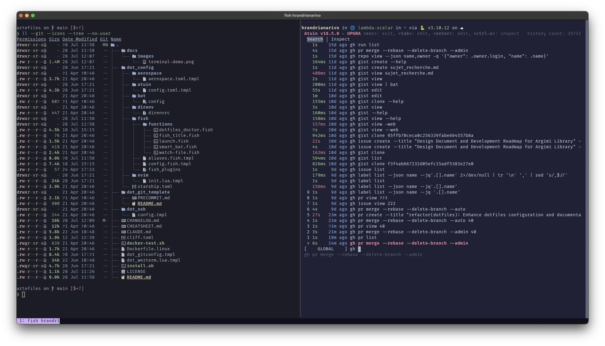

# Artefiles

A ready-to-use terminal setup for macOS and Linux: Fish, Starship, modern CLI tools and a Catppuccin theme, installed with one command and **managed by [chezmoi](https://chezmoi.io/)** so you can edit, update and roll back every config ([commands](#using-chezmoi)).



## Prerequisites

- macOS or Linux (x86_64 or arm64).
- A GitHub account: the installer logs `gh` in and reads your name and email from your profile.
- On macOS, your password once: Homebrew needs `sudo`.

## Install

```bash
sh -c "$(curl -fsLS https://raw.githubusercontent.com/artefactory/artefiles/main/install.sh)"
```

The [script](install.sh) does four things:
1. Installs `gh` and signs you in to GitHub.
2. Installs chezmoi and shows a checklist of optional modules.
3. Applies everything.
4. Offers to make Fish your default shell and to star this repo. If you decline the shell change, the [cheatsheet](CHEATSHEET.md#post-installation-steps) has the commands.

Then open a new terminal (type `fish` if you declined the shell change) and run `dotfiles_doctor` to check the install.

**Variants**

```bash
# Another release, or a branch such as main (the default is the latest release)
ARTEFILES_VERSION=v2026.10.1 sh -c "$(curl -fsLS https://raw.githubusercontent.com/artefactory/artefiles/main/install.sh)"

# No browser (CI, a remote machine): sign in with a token
GH_TOKEN=<token> sh -c "$(curl -fsLS https://raw.githubusercontent.com/artefactory/artefiles/main/install.sh)"
```

In Codespaces, set this repo as your [dotfiles repository](https://github.com/settings/codespaces); it installs itself.

<details><summary>Install without the script</summary>

Install Homebrew (macOS) and `gh`, and log `gh` in first. This route has no checklist: chezmoi's own prompt asks for the modules. Then:

```bash
sh -c "$(curl -fsLS get.chezmoi.io)" -- -b $HOME/.local/bin init --apply \
  --branch "$(gh release view --repo artefactory/artefiles --json tagName --jq .tagName)" artefactory/artefiles
```
</details>

## What you get

Every install gives you the **Fish** shell (suggestions as you type) with the **Starship** prompt, **git**, **gh**, **uv** (Python), **fnm** (Node) and the FiraCode Nerd Font. The install checklist adds the rest as modules; these replace everyday commands:

| Instead of | Use | Module |
|---|---|---|
| `ls` / `cat` / `find` / `grep` | `eza` / `bat` / `fd` / `rg` | `shell_tools` |
| `cd` | `cd` ranked by use ([zoxide](https://github.com/ajeetdsouza/zoxide)) | `shell_tools` |
| `rm` / `du` / `ps` / `sed` | `rip` / `dust` / `procs` / `sd` | `cli_extras` |

**Keys:** `Tab` opens an fzf picker over every completion. `Ctrl+R` searches [Atuin](https://atuin.sh/) history, synced across machines (`atuin` module). `review` opens a terminal UI to review a diff, a branch or a pull request (`review` module). `git diff` uses difftastic (`git_advanced` module).

All modules (`[x]` marks the ones selected by default; without a terminal, chezmoi's own prompt lists them):

| Module | Description | Alternative to |
|--------|-------------|----------------|
| `editor` | Neovim: modal terminal editor with the team configuration (nvim) | — |
| `shell_tools` | Shell tools: bat, eza, fd, fzf, ripgrep, zoxide, direnv (modern cat, ls, find, search, cd) | — |
| `cli_extras` | Faster CLI replacements: dust, dysk, procs, sd, choose, hyperfine, bottom, rip2 | — |
| `rust` | Rust toolchain (rustup, cargo) to build Rust tools | — |
| `ghostty` | Ghostty terminal, preconfigured, plus Zellij (panes and tabs). Alternative to cmux: pick one | `cmux` |
| `cmux` | cmux: Ghostty-based macOS terminal, vertical tabs, agent notifications. Alternative to ghostty: pick one | `ghostty` |
| `git_advanced` | Extra git tools: difftastic (diffs), git-cliff (changelogs), git-lfs, git-extras | — |
| `atuin` | Atuin: searchable shell history, synced across machines (Ctrl+R) | — |
| `review` | tuicr: terminal UI to review a diff, a branch or a pull request (review command) | — |
| `python_dev` | Python tools: nbdime (notebook diffs), VS Code extensions | — |
| `pre_commit` | pre-commit: Git hook manager running linters and formatters on commit. Alternative to prek: pick one | `prek` |
| `prek` | prek: faster Rust drop-in for pre-commit, same config. Alternative to pre_commit: pick one | `pre_commit` |
| `gcloud` | Google Cloud SDK: the gcloud CLI to manage Google Cloud resources | — |
| `containers` | Containers on macOS: Colima (runtime) and the docker CLI | — |
| `terraform` | Terraform: infrastructure-as-code CLI to plan and apply cloud resources. Alternative to opentofu: pick one | `opentofu` |
| `opentofu` | OpenTofu: open-source fork of Terraform, same workflow (tofu). Alternative to terraform: pick one | `terraform` |

After installing: `atuin register` (or `atuin login`) turns on history sync, and `gcloud init` sets up Google Cloud. More commands and shortcuts are in the [cheatsheet](CHEATSHEET.md).

## Using chezmoi

chezmoi keeps a copy of every config in a source directory (`chezmoi source-path` prints it); `chezmoi apply` writes those files into your home directory.

| Task | Command |
|------|---------|
| See pending changes | `chezmoi status` / `chezmoi diff` |
| Edit a file | `chezmoi edit <path>` |
| Apply changes | `chezmoi apply` |
| Update from the repo | `chezmoi update` |
| Reset one file | `chezmoi apply --force <path>` |
| Change modules | `chezmoi init && chezmoi apply` |

## Make it yours

1. **Fork** this repo. On a new machine, clone your fork and run `./install.sh` inside it, or run `chezmoi init --apply <you>/artefiles`. Already installed? Point the existing source at your fork: `git -C "$(chezmoi source-path)" remote set-url origin <your fork URL>`.
2. **Edit** a config: `chezmoi edit ~/.config/fish/config.fish`, check it with `chezmoi diff`, apply it with `chezmoi apply`.
3. **Publish:** `chezmoi cd`, commit, push. Your other machines get it with `chezmoi update`.
4. **Follow upstream:** merges use [mergiraf](https://mergiraf.org/), which merges config files by structure.
   ```bash
   chezmoi cd
   git remote add upstream https://github.com/artefactory/artefiles.git   # once
   git pull upstream main
   chezmoi apply
   ```

## Update

`chezmoi update` moves to the newest [release](https://github.com/artefactory/artefiles/releases) and applies it; a clone on a branch (a fork, or `ARTEFILES_VERSION=<branch>`) pulls that branch instead. Each release lists what changed and what to do about breaking changes.

## More

[CHEATSHEET.md](CHEATSHEET.md) has the commands and shortcuts, running bash snippets in Fish, the sandbox (`./sandbox.sh`), the tests and how to remove everything. MIT licence.
