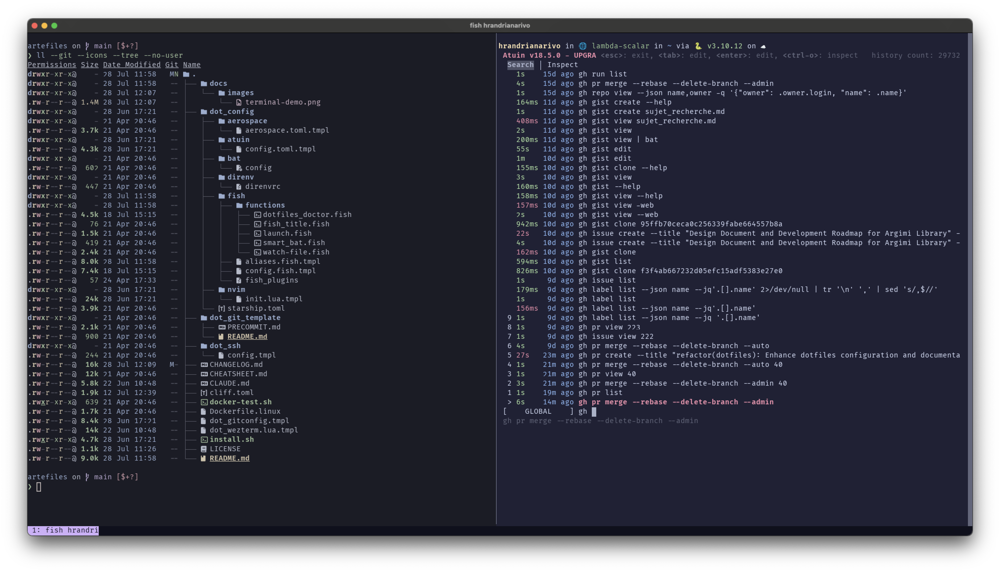

# Artefiles

A ready-to-use terminal setup for macOS and Linux: Fish, Starship, modern CLI tools and a Catppuccin theme, installed with one command and **managed by [chezmoi](https://chezmoi.io/)** so you can edit, update and roll back every config ([commands](#using-chezmoi)).



## Prerequisites

- macOS or Linux (x86_64 or arm64).
- A GitHub account: the installer logs `gh` in and reads your name and email from your profile.
- On macOS, your password once: Homebrew needs `sudo`.

## Install

```bash {"name":"install","excludeFromRunAll":"true"}
sh -c "$(curl -fsLS https://raw.githubusercontent.com/artefactory/artefiles/main/install.sh)"
```

The [script](install.sh) does five things:
1. Checks your machine (system, tools, write access, network) and lists anything to fix before it changes anything.
2. Installs `gh` and signs you in to GitHub.
3. Installs chezmoi and shows a checklist of optional modules.
4. Saves the files it would change in a dated backup folder (under `.local/state/artefiles` in your home), then applies everything. `install.sh --restore <folder>` undoes the install from that folder.
5. Offers to make Fish your default shell and to star this repo. If you decline the shell change, the [cheatsheet](CHEATSHEET.md#default-shell) has the commands. With an `@artefact.com` email, it also says when your GitHub account is not yet in the artefactory organisation.

Then open a new terminal (type `fish` if you declined the shell change) and run `dotfiles_doctor` to check the install.

**Already have dotfiles?** Before it writes anything, the install copies every file it would change into a dated `backup-<date>` folder under `.local/state/artefiles` in your home, and prints that folder with the command to undo the install: `install.sh --restore <folder>`. The restore lists what it will do and asks first. It copies your files back, deletes the files the install created and removes chezmoi's config and its copy of artefiles. Software the install added (Homebrew packages, fish, the tools in `.local`) is not removed; the [cheatsheet](CHEATSHEET.md) lists how to remove it. If chezmoi already manages your dotfiles from another repository in its default folder (`.local/share/chezmoi` in your home), the one-line install stops without touching it and names the folder to move away first (or to update, for an older artefiles clone). A source folder set elsewhere (chezmoi's `sourceDir`) is not checked: move it away before installing.

You can run the install again. At the same version it changes no file, makes no new backup and does not ask you to sign in to GitHub when `gh` already is. If you edited a file the install manages, chezmoi asks before overwriting it; `chezmoi diff` shows your changes.

**Variants**

```bash {"ignore":"true"}
# Another release, or a branch such as main (the default is the latest release)
ARTEFILES_VERSION=main sh -c "$(curl -fsLS https://raw.githubusercontent.com/artefactory/artefiles/main/install.sh)"

# No browser (CI, a remote machine): sign in with a token
GH_TOKEN=<token> sh -c "$(curl -fsLS https://raw.githubusercontent.com/artefactory/artefiles/main/install.sh)"
```

In Codespaces, set this repo as your [dotfiles repository](https://github.com/settings/codespaces); it installs itself.

<details><summary>Install without the script</summary>

Install Homebrew (macOS) and `gh`, and log `gh` in first. This route has no checklist: chezmoi's own prompt asks for the modules. Then:

```bash {"name":"chezmoi-init-direct","excludeFromRunAll":"true"}
sh -c "$(curl -fsLS get.chezmoi.io)" -- -b $HOME/.local/bin init --apply \
  --branch "$(gh release view --repo artefactory/artefiles --json tagName --jq .tagName)" artefactory/artefiles
```
</details>

## What you get

Every install gives you the **Fish** shell (suggestions as you type) with the **Starship** prompt, **git**, **gh**, **uv** (Python), **fnm** (Node) and the FiraCode Nerd Font. The install checklist adds the rest as modules; these replace everyday commands:

| Instead of | Use | Module |
|---|---|---|
| `ls` / `cat` / `find` / `grep` | `eza` / `bat` / `fd` / `rg` | `shell_tools` |
| `cd` | `cd` ranked by use ([zoxide](https://github.com/ajeetdsouza/zoxide)) | `shell_tools` |
| `rm` / `du` / `ps` / `sed` | `rip` / `dust` / `procs` / `sd` | `cli_extras` |

**Keys:** `Tab` opens an fzf picker over every completion. `Ctrl+R` searches [Atuin](https://atuin.sh/) history, synced across machines (`atuin` module). `review` opens a terminal UI to review a diff, a branch or a pull request (`review` module). `git diff` uses difftastic (`git_advanced` module).

All modules (without a terminal, chezmoi's own prompt lists them):

| Module | Description | Alternative to |
|--------|-------------|----------------|
| `editor` | Neovim: modal terminal editor with the team configuration (nvim) | — |
| `shell_tools` | Shell tools: bat, eza, fd, fzf, ripgrep, zoxide, direnv (modern cat, ls, find, search, cd) | — |
| `cli_extras` | Faster CLI replacements: dust, dysk, procs, sd, choose, hyperfine, bottom, rip2 | — |
| `rust` | Rust toolchain (rustup, cargo) to build Rust tools | — |
| `ghostty` | Ghostty terminal, preconfigured: Catppuccin theme, FiraCode Nerd Font, macOS keys | — |
| `herdr` | herdr: terminal workspace for coding agents: split panes, agent status, sessions that survive detach | — |
| `git_advanced` | Extra git tools: difftastic (diffs), git-cliff (changelogs), git-lfs, git-extras, lazygit (TUI) | — |
| `atuin` | Atuin: searchable shell history, synced across machines (Ctrl+R) | — |
| `review` | tuicr: terminal UI to review a diff, a branch or a pull request (review command) | — |
| `python_dev` | Python tools: nbdime (notebook diffs), VS Code extensions | — |
| `vscode` | VS Code: the Microsoft desktop editor (code), with the team settings and extensions | — |
| `code_cli` | VS Code CLI, Linux only, as code-cli: code-cli tunnel opens this machine (macOS: vscode has code tunnel) | — |
| `antigravity` | Google Antigravity on macOS 13+: Google's agent-first IDE (desktop app) | — |
| `claude_code` | Claude Code: Anthropic's coding agent in the terminal (claude), from its self-updating installer | — |
| `codex` | Codex CLI: OpenAI's coding agent in the terminal (codex) | — |
| `pi` | pi: a minimal, extensible coding agent in the terminal (pi), from its official installer | — |
| `data` | Data tools: DuckDB (SQL on CSV and Parquet files) and harlequin (SQL client in the terminal) | — |
| `runme` | Runme: run the shell blocks of the README and the cheatsheet by name | — |
| `pre_commit` | pre-commit: Git hook manager running linters and formatters on commit. Alternative to prek: pick one | `prek` |
| `prek` | prek: faster Rust drop-in for pre-commit, same config. Alternative to pre_commit: pick one | `pre_commit` |
| `gcloud` | Google Cloud SDK: the gcloud CLI to manage Google Cloud resources | — |
| `azure` | Azure CLI: the az command to manage Microsoft Azure resources | — |
| `containers` | Containers on macOS: Colima (runtime), the docker CLI with buildx, and lazydocker | — |
| `kubernetes` | Kubernetes: kubectl, and k9s to browse and manage clusters in the terminal | — |
| `terraform` | Terraform: infrastructure-as-code CLI to plan and apply cloud resources. Alternative to opentofu: pick one | `opentofu` |
| `opentofu` | OpenTofu: open-source fork of Terraform, same workflow (tofu). Alternative to terraform: pick one | `terraform` |

Selected by default: `editor`, `shell_tools`, `cli_extras`, `rust`, `ghostty`, `herdr`, `git_advanced`, `atuin`, `python_dev`, `vscode`, `code_cli`, `gcloud`.

After installing: `atuin register` (or `atuin login`) turns on history sync, `gcloud init` sets up Google Cloud, and `az login` signs in to Azure. More commands and shortcuts are in the [cheatsheet](CHEATSHEET.md).

## Using chezmoi

chezmoi keeps a copy of every config in a source directory (`chezmoi source-path` prints it); `chezmoi apply` writes those files into your home directory.

Copy a block into your terminal, changing the value after `export` if you need to. Or, with the optional `runme` module, run it by name, `runme run chezmoi-check`: [Runme](CHEATSHEET.md#run-these-steps-with-runme) shows each value for you to confirm before it runs.

**Check** what would change (`chezmoi-check`, read-only):

```sh {"name":"chezmoi-check","interactive":"false","tag":"check"}
chezmoi status
chezmoi diff --no-pager
```

**Edit** a config in your editor, review it, then apply it (`chezmoi-edit`):

```sh {"name":"chezmoi-edit","excludeFromRunAll":"true"}
export FILE="$HOME/.config/fish/config.fish"
chezmoi edit "$FILE"
chezmoi diff --no-pager "$FILE"
chezmoi apply -v "$FILE"
```

**Update** from the repo: pull the latest changes, then apply them (`chezmoi-update`):

```sh {"name":"chezmoi-update","excludeFromRunAll":"true"}
chezmoi update -v
```

**Change modules**: answer the checklist again, then apply (`chezmoi-modules`):

```sh {"name":"chezmoi-modules","excludeFromRunAll":"true"}
chezmoi init --prompt && chezmoi apply
```

To track a new file, merge edits made outside chezmoi, preview an update or reset one file, see the [cheatsheet](CHEATSHEET.md#chezmoi-workflows).

## Make it yours

1. **Fork** this repo. On a new machine, clone your fork and run `./install.sh` inside it, or run `chezmoi init --apply <you>/artefiles`. Already installed? Point the existing source at your fork: `git -C "$(chezmoi source-path)" remote set-url origin <your fork URL>`.
2. **Edit** a config: `chezmoi edit ~/.config/fish/config.fish`, check it with `chezmoi diff`, apply it with `chezmoi apply`.
3. **Publish:** commit and push from the source directory. Your other machines get it with `chezmoi update`.
   ```bash {"name":"publish-changes","excludeFromRunAll":"true"}
   export MESSAGE="Update my dotfiles"
   cd "$(chezmoi source-path)"
   git add -A
   git commit -m "$MESSAGE"
   git push
   ```
4. **Follow upstream:** merges use [mergiraf](https://mergiraf.org/), which merges config files by structure.
   ```bash {"name":"follow-upstream","excludeFromRunAll":"true"}
   cd "$(chezmoi source-path)"
   git remote get-url upstream > /dev/null 2>&1 \
     || git remote add upstream https://github.com/artefactory/artefiles.git
   git pull upstream main
   chezmoi apply
   ```

## Update

`chezmoi update` moves to the newest [release](https://github.com/artefactory/artefiles/releases) and applies it; a clone on a branch (a fork, or `ARTEFILES_VERSION=<branch>`) pulls that branch instead. Each release lists what changed and what to do about breaking changes.

## More

[CHEATSHEET.md](CHEATSHEET.md) has the chezmoi commands, a guide per module, the sandbox (`./sandbox.sh`), the tests and how to remove everything. MIT licence.

Every shell block of this README and the cheatsheet works when pasted. With the optional `runme` module, [Runme](https://docs.runme.dev) also runs them by name from the source directory ([how](CHEATSHEET.md#run-these-steps-with-runme)).

Claude Code can help you install, update, debug and use these tools in any project once the artefiles skill is installed: `gh skill install artefactory/artefiles .claude/skills/artefiles/SKILL.md --allow-hidden-dirs --agent claude-code --scope user`.
